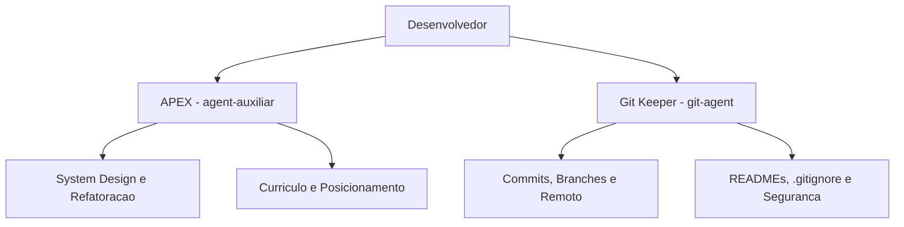

# Agentes Inteligentes de Suporte ao Desenvolvimento e Performance

Configuracoes declarativas e instrucoes operacionais de agentes autônomos de Inteligência Artificial para governança Git e mentoria técnica de alta performance.

## Visao geral

Este repositorio centraliza a definicao de personas, matrizes de permissao e diretrizes operacionais de agentes inteligentes de IA, desenvolvidos para atuar diretamente no ambiente de trabalho do desenvolvedor. A solucao combina governanca estrita de versionamento de software com suporte a decisoes de arquitetura, system design e preparacao para o mercado de tecnologia.

## Agentes disponiveis

### 1. Git Keeper (`git-agent`)

Agente focado em governanca de codigo, versionamento e gestao de repositorios Git e GitHub no ambiente Linux:

- Auditoria previa de arquivos antes de qualquer commit.
- Varredura automatizada contra vazamento de segredos e credenciais.
- Padronizacao de historico via Conventional Commits em passos atomicos.
- Documentacao tecnica completa de projetos segundo padroes corporativos.
- Integracao e automacao com GitHub CLI (`gh`).

### 2. APEX (`agent-auxiliar`)

Agente de mentoria tecnica e performance extrema (estilo Staff Engineer / CTO):

- Revisao critica de escolhas arquiteturais e System Design.
- Analise de complexidade assintotica (Big O) e boas praticas de Clean Code.
- Auditoria de curriculo com foco no framework XYZ (impacto quantificavel).
- Orientacao voltada a desafios reais nas areas de Engenharia de Dados, Backend e IA.

## Tecnologias

| Camada | Tecnologia |
|---|---|
| Formato de Definicao | Markdown e YAML Frontmatter |
| Especificacao | AGENTS.md / Harness de Agentes |
| Controle de Versao | Git / GitHub CLI |
| Ambiente de Execucao | Linux Mint / Bash |

## Arquitetura e estrutura de pastas

Relacao e escopo de atuacao dos agentes no fluxo de desenvolvimento:



Estrutura de arquivos do repositorio:

```
.
|-- .gitattributes              normalizacao de quebras de linha
|-- .gitignore                  regras de exclusao para Git
|-- LICENSE                     licenca MIT
|-- README.md                   documentacao tecnica do repositorio
|-- agent-auxiliar/
|   `-- agent.md                definicao e diretrizes do agente APEX
`-- git-agent/
    `-- agent.md                definicao e diretrizes do agente Git Keeper
```

## Pre-requisitos

- Ambiente compatível com execucao de agentes baseados em arquivos de instrucao (`agent.md`).
- Git 2.40+ instalado.
- GitHub CLI (`gh`) autenticado (para operacoes do `git-agent`).

## Instalacao e utilizacao

Clone o repositorio na sua maquina local:

```bash
git clone https://github.com/Rafael-Boaro/agentes.git
cd agentes
```

Para utilizar as configuracoes no harness local de agentes (ex: Antigravity CLI ou compativeis), copie os diretorios para a pasta padrao de agentes:

```bash
mkdir -p ~/.agents/agents
cp -r git-agent ~/.agents/agents/
cp -r agent-auxiliar ~/.agents/agents/
```

## Decisoes tecnicas

- **Estrutura Declarativa em Markdown:** Uso de arquivos `.md` com frontmatter YAML, garantindo portabilidade, facilidade de leitura e compativel com padroes abertos de agentes.
- **Segregacao de Responsabilidades:** Divisao clara entre o agente executor de governanca operacional (`git-agent`) e o mentor estrategico de arquitetura (`agent-auxiliar`), evitando sobreposicao de escopos e conflito de diretrizes.
- **Politica Zero Emojis e Texto Objetivo:** Ambos os agentes operam sob diretriz de comunicacao concisa, focada em dados e rigor profissional.

## Roadmap

- [ ] Adicionar agente especialista em Pipelines de Dados e Engenharia de Analytics.
- [ ] Implementar testes automatizados de sintaxe e validacao dos arquivos de instrucao via GitHub Actions.

## Autor

Rafael Paolielo Boaro  
GitHub: [Rafael-Boaro](https://github.com/Rafael-Boaro)

## Licenca

Distribuido sob a licenca MIT. Veja o arquivo LICENSE para mais detalhes.
