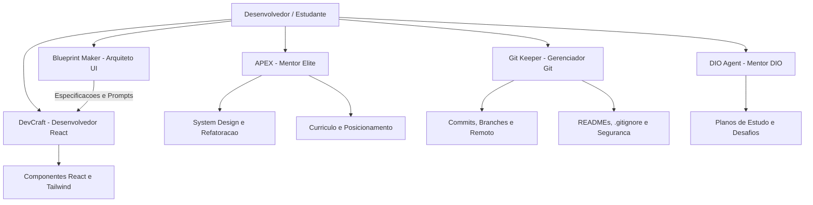

# Agentes Inteligentes de Suporte ao Desenvolvimento e Performance

Configuracoes declarativas e instrucoes operacionais de agentes autonomos de Inteligencia Artificial para governanca Git, desenvolvimento front-end, arquitetura de interfaces e mentoria tecnica.

## Visao geral

Este repositorio centraliza a definicao de personas, matrizes de permissao e diretrizes operacionais de agentes inteligentes de IA, desenvolvidos para atuar diretamente no ambiente de trabalho do desenvolvedor. A solucao combina governanca estrita de versionamento de software com suporte a desenvolvimento web, system design, refinamento visual e capacitacao tecnica continua.

## Agentes disponiveis

### 1. Git Keeper (`git-agent`)

Agente focado em governanca de codigo, versionamento e gestao de repositorios Git e GitHub no ambiente Linux:

- Auditoria previa de arquivos antes de qualquer commit.
- Varredura automatizada contra vazamento de segredos e credenciais.
- Padronizacao de historico via Conventional Commits em passos atomicos.
- Documentacao tecnica completa de projetos segundo padroes corporativos.
- Integracao e automacao com GitHub CLI (`gh`).

### 2. Mentor Elite / APEX (`agent-auxiliar`)

Agente de mentoria tecnica e performance extrema (estilo Staff Engineer / CTO):

- Revisao critica de escolhas arquiteturais e System Design.
- Analise de complexidade assintotica (Big O) e boas praticas de Clean Code.
- Auditoria de curriculo com foco no framework XYZ (impacto quantificavel).
- Orientacao voltada a desafios reais nas areas de Engenharia de Dados, Backend e IA.

### 3. Mentor DIO (`dio-agent`)

Mentor educacional de inteligencia artificial voltado a estudantes de tecnologia da plataforma DIO:

- Conducao pedagogica baseada em Problem-Based Learning sem entrega direta de solucoes.
- Suporte estruturado para destravamento de Desafios de Codigo e Desafios de Projeto.
- Elaboracao e acompanhamento de planos de estudo personalizados.
- Orientacao sobre carreiras de IA (AI Builder, AI Developer) e revisao de portfolio.

### 4. DevCraft Front-end (`frontend-dev-agent`)

Engenheiro de software front-end focado em interfaces modernas, componentizadas e acessiveis:

- Desenvolvimento em React 18+, Vite, TypeScript estrito e Tailwind CSS.
- Abordagem Mobile-First, semantica HTML e acessibilidade (a11y).
- Separacao rigorosa entre camada de apresentacao, tipos e dados (mocks).
- Padrao de componentes modulares de baixa complexidade (arquivos com menos de 150 linhas).

### 5. Blueprint Maker (`web-blueprint-agent`)

Arquiteto de UX/UI e engenheiro de prompts especializado em interfaces web:

- Transformacao de ideias brutas em especificacoes visuais e tecnicas detalhadas.
- Definicao de paleta de cores, tipografia, secoes e jornadas de usuario utilizando utilitarios Tailwind CSS.
- Geracao de prompts estruturados para orientar agentes desenvolvedores front-end.
- Foco em design moderno, microinteracoes e consistencia visual.

## Tecnologias

| Camada | Tecnologia |
|---|---|
| Formato de Definicao | Markdown e YAML Frontmatter |
| Especificacao | AGENTS.md / Harness de Agentes |
| Controle de Versao | Git / GitHub CLI |
| Stacks Suportadas | React, Vite, TypeScript, Tailwind CSS, Python, SQL |
| Ambiente de Execucao | Linux Mint / Bash |

## Arquitetura e fluxo de trabalho

Relacao e escopo de atuacao dos agentes no ciclo de desenvolvimento:



Estrutura de arquivos do repositorio:

```
.
|-- .gitattributes              normalizacao de quebras de linha
|-- .gitignore                  regras de exclusao para Git
|-- LICENSE                     licenca MIT
|-- README.md                   documentacao tecnica do repositorio
|-- agent-auxiliar/
|   `-- agent.md                definicao e diretrizes do agente APEX / Mentor Elite
|-- dio-agent/
|   `-- agent.md                definicao e diretrizes do agente DIO Agent
|-- frontend-dev-agent/
|   `-- agent.md                definicao e diretrizes do agente DevCraft Front-end
|-- git-agent/
|   `-- agent.md                definicao e diretrizes do agente Git Keeper
`-- web-blueprint-agent/
    `-- agent.md                definicao e diretrizes do agente Blueprint Maker
```

## Pre-requisitos

- Ambiente compativel com execucao de agentes baseados em arquivos de instrucao (`agent.md`).
- Git 2.40+ instalado.
- GitHub CLI (`gh`) autenticado (para operacoes do `git-agent`).

## Instalacao e utilizacao

Clone o repositorio na sua maquina local:

```bash
git clone https://github.com/Rafael-Boaro/agentes.git
cd agentes
```

Para disponibilizar as instrucoes no harness local de agentes (ex: Antigravity CLI ou compativeis), sincronize os diretorios para a pasta padrao de agentes:

```bash
mkdir -p ~/.agents/agents
cp -r agent-auxiliar dio-agent frontend-dev-agent git-agent web-blueprint-agent ~/.agents/agents/
```

## Decisoes tecnicas

- **Estrutura Declarativa em Markdown:** Uso de arquivos `.md` com frontmatter YAML, garantindo portabilidade, facilidade de leitura e interoperabilidade com diferentes harnesses de agentes.
- **Segregacao de Responsabilidades:** Divisao estrita de escopos entre governanca operacional (`git-agent`), mentoria de engenharia (`agent-auxiliar`), mentoria educacional (`dio-agent`), especificacao visual (`web-blueprint-agent`) e implementacao front-end (`frontend-dev-agent`).
- **Politica Zero Emojis e Texto Objetivo:** Comunicacao tecnica concisa, rigorosa e focada em resultados auditaveis.

## Autor

Rafael Paolielo Boaro  
GitHub: [Rafael-Boaro](https://github.com/Rafael-Boaro)

## Licenca

Distribuido sob a licenca MIT. Veja o arquivo LICENSE para mais detalhes.
